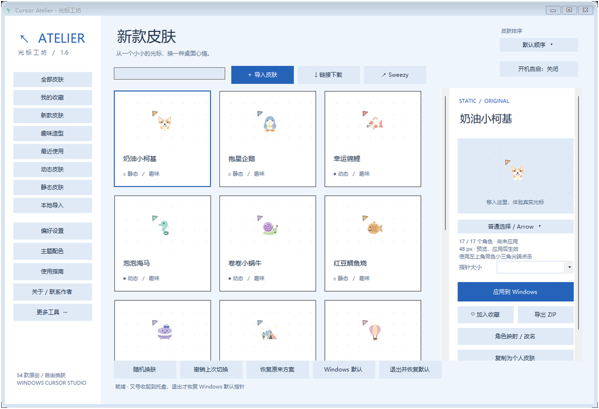
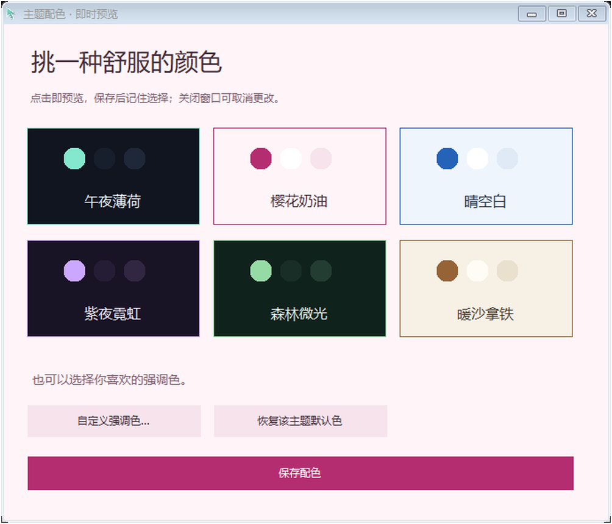
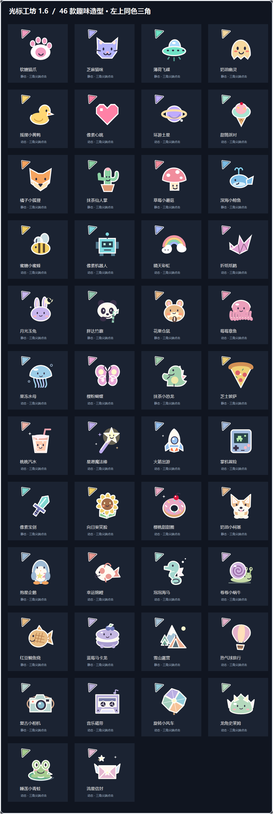
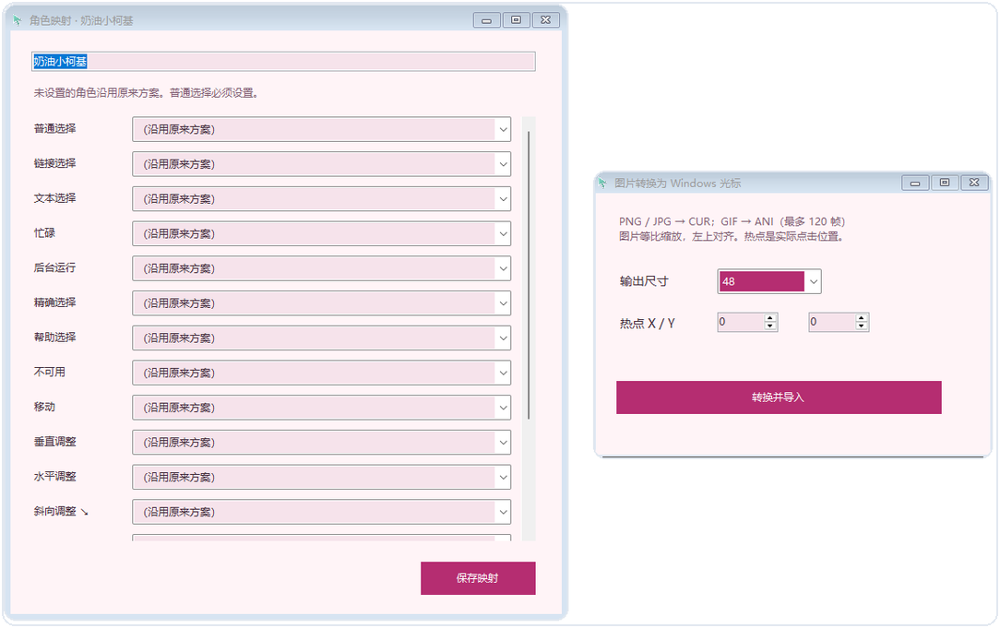
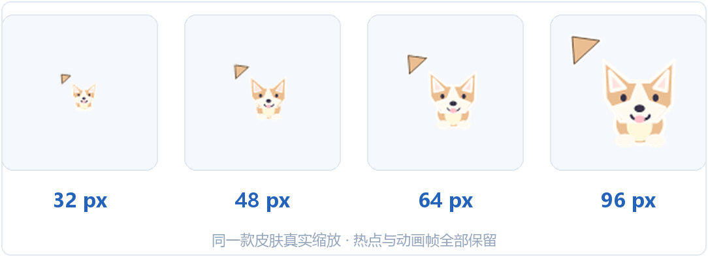
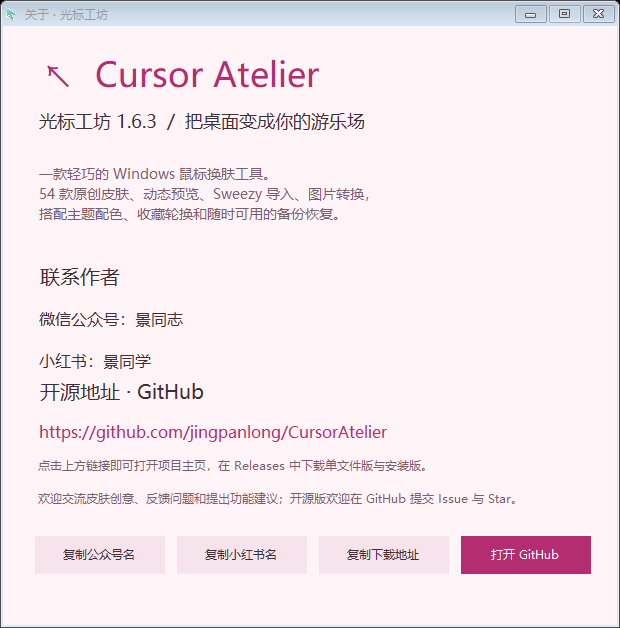
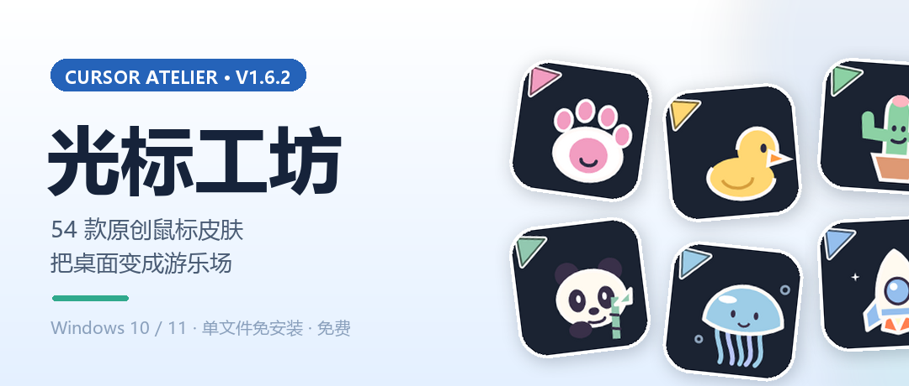

<div align="center">

# ↖ Cursor Atelier · 光标工坊

**一款轻巧的 Windows 鼠标换肤工具 —— 把桌面变成你的游乐场**

54 款原创皮肤 · 动态预览 · Sweezy 导入 · 图片转换 · 六套主题配色

[](https://github.com/jingpanlong/CursorAtelier/releases)
[]()
[]()
[](LICENSE)
[]()

**[⬇️ 前往 Releases 下载](https://github.com/jingpanlong/CursorAtelier/releases)**

</div>

---

## ✨ 它能做什么

**光标工坊**是一个免费、开源、纯本地的 Windows 鼠标指针换肤工具。
不需要安装任何运行库，单文件约 200 KB，双击即用。

### 🎨 54 款原创皮肤，30 款动态

所有皮肤均由代码绘制生成（非图片素材拼凑），覆盖 17 个 Windows 系统指针角色：

| 分类 | 内容 |
|---|---|
| 趣味造型（46 款） | 柯基、企鹅、锦鲤、海马、蜗牛、鲷鱼烧、马卡龙、露营、热气球、相机、磁带、风车、史莱姆、青蛙、流星信封…… |
| 新款皮肤 | 每个版本持续追加，旧版皮肤 ID 与个人数据始终保留 |
| 30 款动态皮肤 | 原生 ANI 动画编码，帧数完整保留 |

### 👀 动态预览，所见即所得

- 鼠标移入预览区即可**真实体验**当前指针，不用先应用；
- 支持按卡片双击快速应用；
- 应用前自动备份原方案，随时一键恢复。

### 📥 Sweezy 导入 & 图片转换

- 直接拖入 Sweezy Cursor / Pointer / Complete Pack 的 ZIP 包即可导入；
- 也支持粘贴 Sweezy 皮肤页面链接在线下载；
- `CUR / ANI` 支持四档缩放（32/48/64/96px），热点等比调整、动画完整保留；
- `PNG / GIF` 可一键转换为原生指针。

### 🖼 全部 17 个角色映射

Arrow、Hand、Help、AppStarting、Wait、Crosshair、IBeam、No、SizeAll、SizeNESW、SizeNS、SizeNWSE、SizeWE、UpArrow、Pin、Person……
导入第三方皮肤后可自由调整映射，缺失角色自动沿用原方案。

### 🌈 六套主题配色 + 自定义强调色

午夜薄荷 / 樱花奶油 / 晴空白 / 紫夜霓虹 / 森林微光 / 暖沙拿铁，全部主题均通过文本对比度校验。

### 📐 四档尺寸，单款独立调节

32 / 48 / 64 / 96px，全局尺寸与单款独立尺寸并存，生成在后台执行、可取消，并带内容哈希缓存。

### 🔄 收藏轮换 & 备份恢复

- 收藏喜欢的皮肤，开启自动轮换，让指针按周期随机变化；
- 一键备份全部/收藏皮肤为 ZIP（含收藏状态），跨设备恢复；
- 应用皮肤前自动快照注册表原方案，支持撤销与应急恢复。

### 🧰 更多贴心细节

- 开机自启（以托盘方式静默启动）
- 关闭窗口收起到托盘，指针持续生效
- 快捷键：`Ctrl+Alt+R` 恢复 · `Ctrl+Alt+N` 随机 · `Ctrl+Alt+S` 显示窗口
- 高 DPI 适配，任意缩放下界面清晰可用

---

## 📸 界面预览

| 主界面 | 主题配色 |
|:---:|:---:|
|  |  |

| 趣味造型 | 新款皮肤 |
|:---:|:---:|
|  |  |

| Sweezy 导入与角色映射 | 四档尺寸对比 |
|:---:|:---:|
|  |  |

| 关于窗口（含开源地址） | 封面 |
|:---:|:---:|
|  |  |

---

## ⬇️ 下载安装

前往 [**Releases**](https://github.com/jingpanlong/CursorAtelier/releases) 页面，两个版本功能完全一致，任选其一：

| 文件 | 说明 |
|---|---|
| `CursorAtelier-1.6.3.exe` | **单文件版**，免安装，双击即用 |
| `CursorAtelier-Setup-1.6.3.exe` | **安装版**，含开始菜单/桌面快捷方式与卸载器 |

> 系统要求：Windows 7 及以上，已启用 .NET Framework 4.7.2（Win10/11 默认已内置）。
>
> 下载后可用 `SHA256SUMS.txt` 核对文件哈希；安装版也可用
> `CursorAtelier-Setup.exe --verify-payload <目录>` 提取内嵌主程序自行比对。

---

## 🛠 从源码构建

无需 Visual Studio，无需 dotnet SDK，只要 64 位 Windows 自带的 .NET Framework 编译器即可：

```powershell
git clone https://github.com/jingpanlong/CursorAtelier.git
cd CursorAtelier
powershell -NoProfile -ExecutionPolicy Bypass -File .\build.ps1
```

指定输出目录：

```powershell
powershell -NoProfile -ExecutionPolicy Bypass -File .\build.ps1 -OutputDirectory C:\your-output
```

构建产物：

- `CursorAtelier.exe` —— 主程序（单文件版）
- `CursorAtelier-Setup.exe` —— 安装器（将主程序作为内嵌资源打包）

> 技术栈：C# / Windows Forms / .NET Framework 4.7.2+ / AnyCPU
> 编译器：`%WINDIR%\Microsoft.NET\Framework64\v4.0.30319\csc.exe`
> 运行时零第三方依赖、零 NuGet 包，54 款皮肤全部由 `Art*.cs` 代码绘制生成。

---

## 📁 项目结构

```
CursorAtelier/
├── build.ps1                 一键构建脚本（主程序 + 安装器）
├── app.ico / app.manifest    图标与 DPI/权限清单
├── src/
│   ├── App.cs                程序入口与 CLI 测试入口
│   ├── Core.cs               导入导出、配置、注册表快照、应用与恢复事务
│   ├── Art.cs                皮肤绘制核心：CUR/DIB 与 ANI 编码、图片转换
│   ├── ArtExtras.cs          趣味造型 + 1.5 新增皮肤
│   ├── ArtSecondExtras.cs    1.6 新增 15 款皮肤
│   ├── UI.cs                 皮肤库、预览、搜索、收藏、主题、帮助
│   ├── Features.cs           主题配色、关于、映射、备份、排序、自启开关
│   ├── Reliability.cs        菜单生命周期、自启动、退出恢复、配置校验、日志
│   ├── Sizing.cs             后台尺寸准备、缩放、任务取消、内容哈希缓存
│   ├── ActualCursors.cs      原生像素尺寸加载、系统角色映射与校验
│   ├── Installer.cs          当前用户安装、快捷方式、卸载
│   ├── AssemblyInfo.cs       版本信息
│   └── *Tests.cs             回归测试（--self-test 等入口）
└── docs/screenshots/         界面截图
```

**几处值得一提的实现细节：**

- **真原生尺寸加载**：使用 `LoadImage(IMAGE_CURSOR, LR_LOADFROMFILE)` 而非 `LoadCursorFromFile`，避免 96px 指针被系统静默降为 32px；应用后再经 `LoadCursor + GetIconInfo` 回读共享系统指针的实际位图尺寸，不匹配即自动回滚。
- **安装器内嵌主程序**：安装器通过 `/resource:` 打包主程序，`--verify-payload` 可提取比对 SHA256，保证分发一致性。
- **高 DPI 自绘兜底**：自启动开关等控件在 `Paint` 事件中用 `TextRenderer` 主动绘制文字，任何缩放比例下都不会丢字。

---

## 🧪 回归测试

程序内置多组自测入口，均可在不影响桌面的情况下验证（涉及系统指针的用例会在 `finally` 中恢复现场）：

```powershell
# 素材、导入导出、主题、配置等基础校验（15 项，不改桌面）
.\build\CursorAtelier.exe --self-test C:\test\empty-dir

# 文件缩放、时序、响应和取消（不改桌面）
.\build\CursorAtelier.exe --size-test C:\test\empty-dir <SweezyZIP>

# 菜单生命周期、映射、配置、下载（不改桌面）
.\build\CursorAtelier.exe --reliability-test C:\test\empty-dir

# 实际应用 54 款皮肤的 17 角色 × 4 尺寸并校验系统热点/动画（临时修改系统指针，自动恢复）
.\build\CursorAtelier.exe --new-skins-test C:\test\empty-dir
```

> 完整 CLI 参数列表见源码内注释；测试请**每次使用新的空目录**。

---

## 📄 许可证

本项目基于 [MIT License](LICENSE) 开源。

- ✅ 源码与 54 款原创皮肤均可自由使用、修改、分发；
- ⚠️ 不覆盖用户导入的第三方光标文件：Sweezy 等第三方皮肤版权归原作者，本项目与其无隶属关系。

---

<div align="center">

**如果这个工具帮到了你，欢迎点一个 ⭐ Star 支持！**

反馈问题 / 提交创意：[Issues](https://github.com/jingpanlong/CursorAtelier/issues)

微信公众号：**景同志** ｜ 小红书：**景同学**

</div>
