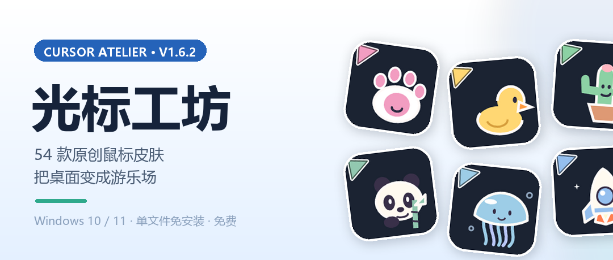
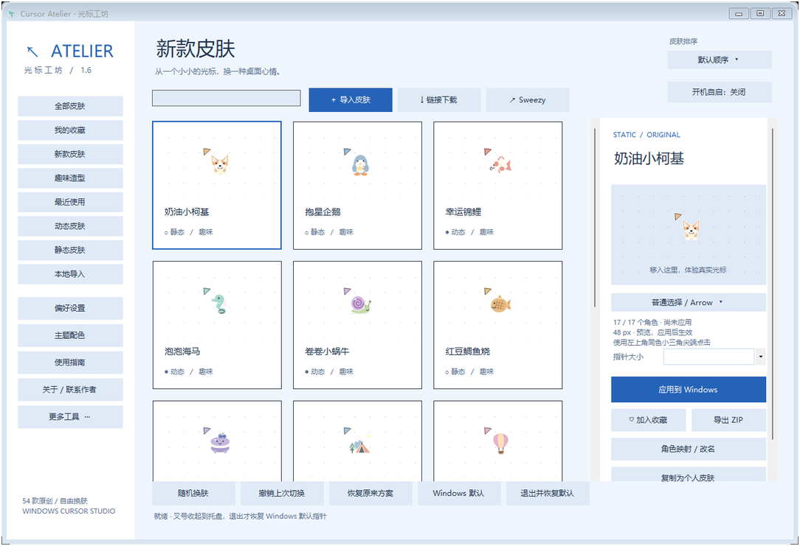
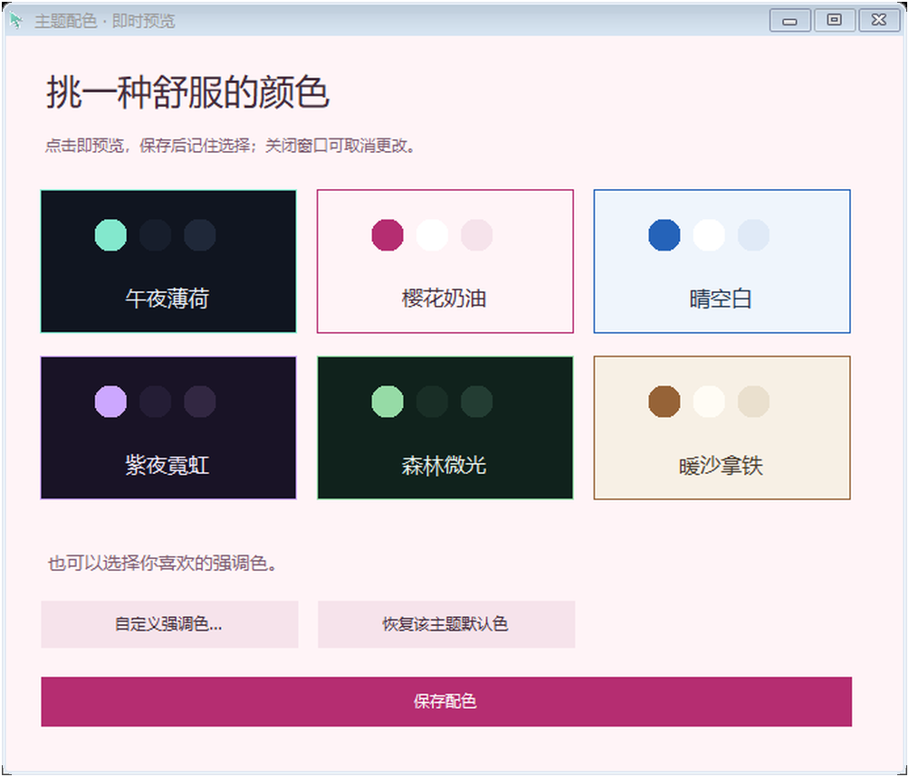
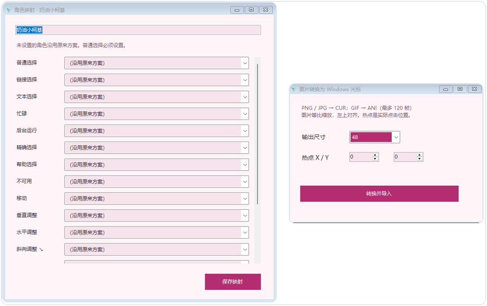
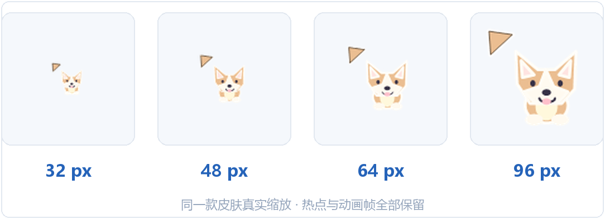
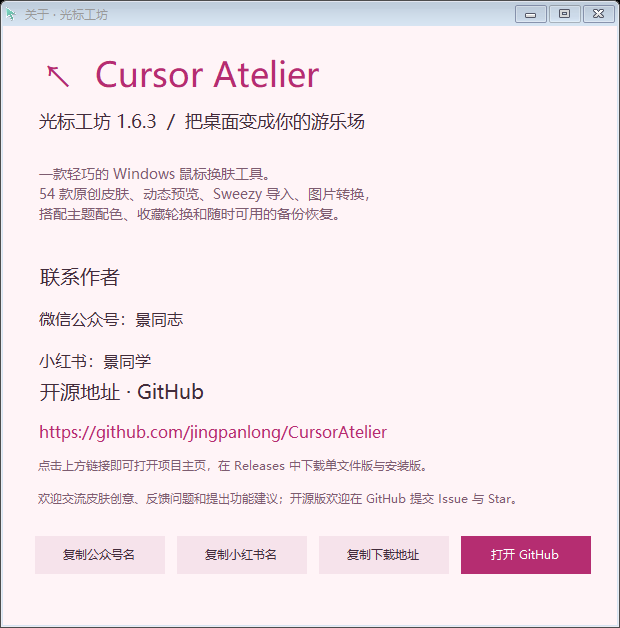

<div align="center">

# ↖ Cursor Atelier (光标工坊)

**A lightweight Windows mouse cursor skinning tool — turn your desktop into a playground**

54 original skins · Live preview · Sweezy import · Image conversion · Six theme palettes



[](https://github.com/jingpanlong/CursorAtelier/releases)
[]()
[]()
[](LICENSE)
[]()

**[⬇️ Download from Releases](https://github.com/jingpanlong/CursorAtelier/releases)**

</div>

---

## ✨ What it does

**Cursor Atelier** is a free, open-source, fully local Windows mouse-cursor skinning tool. No runtime libraries to install, a single file of about 200 KB, double-click and it runs.

### 🎨 54 original skins, 30 animated
All skins are drawn in code (not assembled from image assets), covering 17 Windows system cursor roles:

| Category | Content |
|---|---|
| Fun shapes (46) | Corgi, penguin, koi, seahorse, snail, taiyaki, macaron, camping, hot-air balloon, camera, cassette, windmill, slime, frog, shooting-star envelope… |
| New skins | Added every release; old skin IDs and personal data are always preserved |
| 30 animated skins | Native ANI animation encoding, full frame counts preserved |

### 👀 Live preview, what you see is what you get
- Hover into the preview area to **really experience** the current cursor, without applying it first.
- Double-click a card to apply quickly.
- The original scheme is auto-backed-up before applying, with one-click restore anytime.

### 📥 Sweezy import & image conversion
- Drag in a Sweezy Cursor / Pointer / Complete Pack ZIP to import directly.
- Paste a Sweezy skin-page link to download online.
- `CUR / ANI` support four scale levels (32/48/64/96px), with proportional hotspot adjustment and full animation preserved.
- `PNG / GIF` can be converted to native cursors with one click.

### 🖼 All 17 roles mapped
Arrow, Hand, Help, AppStarting, Wait, Crosshair, IBeam, No, SizeAll, SizeNESW, SizeNS, SizeNWSE, SizeWE, UpArrow, Pin, Person… After importing third-party skins you can freely adjust the mapping; missing roles fall back to the original scheme automatically.

### 🌈 Six theme palettes + custom accent
Midnight Mint / Sakura Cream / Clear Sky / Neon Night / Forest Glow / Warm Latte — all themes pass text-contrast checks.

### 📐 Four sizes, per-skin adjustment
32 / 48 / 64 / 96px; global size and per-skin size coexist, generation runs in the background and is cancellable, with content-hash caching.

### 🔄 Favorites rotation & backup/restore
- Favorite skins you like, enable auto-rotation to vary the cursor periodically.
- One click backs up all/favorite skins to a ZIP (including favorite state) for cross-device restore.
- The registry's original scheme is auto-snapshotted before applying a skin, with undo and emergency restore.

### 🧰 More thoughtful details
- Auto-start (silent tray launch).
- Closing the window collapses to the tray; the cursor stays active.
- Hotkeys: `Ctrl+Alt+R` restore · `Ctrl+Alt+N` random · `Ctrl+Alt+S` show window.
- High-DPI aware; the UI stays crisp at any scaling.

---

## 📸 Screenshots

| Main window | Theme palettes |
|:---:|:---:|
|  |  |

| Fun shapes | New skins |
|:---:|:---:|
|  |  |

| Sweezy import & role mapping | Size comparison |
|:---:|:---:|
|  |  |

| About window (with open-source link) | |
|:---:|:---:|
|  | |

---

## ⬇️ Download & install

Go to the [**Releases**](https://github.com/jingpanlong/CursorAtelier/releases) page. Both builds are functionally identical; pick either:

| File | Notes |
|---|---|
| `CursorAtelier-1.6.3.exe` | **Single-file build**, no install, double-click to run |
| `CursorAtelier-Setup-1.6.3.exe` | **Installer**, with Start Menu / desktop shortcut and uninstaller |

> Requirements: Windows 7 or later, with .NET Framework 4.7.2 enabled (Win10/11 have it built in).
>
> After downloading you can verify the file hash with `SHA256SUMS.txt`; the installer also supports
> `CursorAtelier-Setup.exe --verify-payload <directory>` to extract the embedded main program for comparison.

---

## 🛠 Build from source

No Visual Studio, no dotnet SDK — just the .NET Framework compiler built into 64-bit Windows:

```powershell
git clone https://github.com/jingpanlong/CursorAtelier.git
cd CursorAtelier
powershell -NoProfile -ExecutionPolicy Bypass -File .\build.ps1
```

Custom output directory:

```powershell
powershell -NoProfile -ExecutionPolicy Bypass -File .\build.ps1 -OutputDirectory C:\your-output
```

Build outputs:
- `CursorAtelier.exe` — main program (single-file build)
- `CursorAtelier-Setup.exe` — installer (packages the main program as an embedded resource)

> Tech stack: C# / Windows Forms / .NET Framework 4.7.2+ / AnyCPU
> Compiler: `%WINDIR%\Microsoft.NET\Framework64\v4.0.30319\csc.exe`
> Zero third-party runtime dependencies, zero NuGet packages; all 54 skins are drawn in code in `Art*.cs`.

---

## 📁 Project structure

```
CursorAtelier/
├── build.ps1                 One-click build script (main + installer)
├── app.ico / app.manifest    Icon and DPI/permission manifest
├── src/
│   ├── App.cs                Program entry and CLI test entry
│   ├── Core.cs               Import/export, config, registry snapshot, apply & restore transaction
│   ├── Art.cs                Skin drawing core: CUR/DIB and ANI encoding, image conversion
│   ├── ArtExtras.cs          Fun shapes + 1.5 new skins
│   ├── ArtSecondExtras.cs    1.6 fifteen new skins
│   ├── UI.cs                 Skin library, preview, search, favorites, themes, help
│   ├── Features.cs           Theme palettes, about, mapping, backup, sorting, autostart toggle
│   ├── Reliability.cs        Menu lifecycle, autostart, exit restore, config validation, logging
│   ├── Sizing.cs             Background size preparation, scaling, task cancellation, content-hash cache
│   ├── ActualCursors.cs      Native pixel-size loading, system role mapping & validation
│   ├── Installer.cs          Per-user install, shortcuts, uninstall
│   ├── AssemblyInfo.cs       Version info
│   └── *Tests.cs             Regression tests (--self-test and similar entries)
└── docs/screenshots/         UI screenshots
```

**A few implementation details worth noting:**
- **True native-size loading**: uses `LoadImage(IMAGE_CURSOR, LR_LOADFROMFILE)` instead of `LoadCursorFromFile`, to avoid the system silently demoting 96px cursors to 32px; after applying, it reads back the actual bitmap size of the shared system cursor via `LoadCursor + GetIconInfo`, and auto-rolls back on mismatch.
- **Installer embeds the main program**: the installer packages the main program via `/resource:`; `--verify-payload` can extract and compare SHA256 to guarantee distribution consistency.
- **High-DPI self-draw fallback**: controls such as the autostart toggle actively draw text with `TextRenderer` in the `Paint` event, so no text is dropped at any scaling.

---

## 🧪 Regression tests

The program has several built-in self-test entries that verify behavior without affecting the desktop (cases touching system cursors restore state in `finally`):

```powershell
# Assets, import/export, themes, config, etc. (15 checks, no desktop change)
.\build\CursorAtelier.exe --self-test C:\test\empty-dir

# File scaling, timing, response and cancellation (no desktop change)
.\build\CursorAtelier.exe --size-test C:\test\empty-dir <SweezyZIP>

# Menu lifecycle, mapping, config, download (no desktop change)
.\build\CursorAtelier.exe --reliability-test C:\test\empty-dir

# Actually apply all 54 skins' 17 roles x 4 sizes and verify system hotspots/animation (temporarily changes system cursors, auto-restored)
.\build\CursorAtelier.exe --new-skins-test C:\test\empty-dir
```

> The full CLI argument list is in the source comments; **use a fresh empty directory** for each test.

---

## 📄 License

This project is open source under the [MIT License](LICENSE).

- ✅ Source and the 54 original skins are free to use, modify, and distribute.
- ⚠️ This does not cover third-party cursor files the user imports: Sweezy and other third-party skins remain the property of their original authors; this project is not affiliated with them.

---

<div align="center">

**If this tool helped you, a ⭐ Star would be appreciated!**

Issues / ideas: [Issues](https://github.com/jingpanlong/CursorAtelier/issues)

WeChat Official Account: **景同志** ｜ Xiaohongshu: **景同学**

</div>
